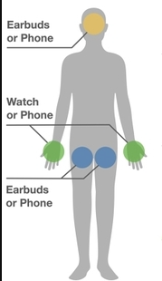
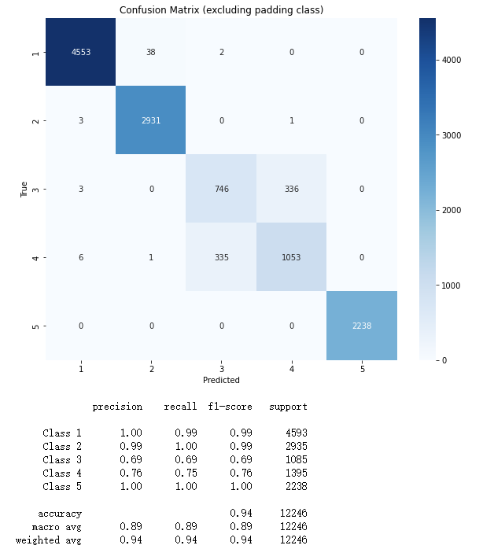

## Problem

Consumer IMU devices (e.g., phones, watches, earbuds) are commonly carried in a small set of on-body locations. This project predicts **where each IMU stream is located** when **2–5 IMU devices** are present.

**Target locations (5-way classification):**

- Left wrist
- Right wrist
- Left pants pocket
- Right pants pocket
- Head

<em>Figure: On-body location illustration (from IMUPoser dataset)</em>

## Implementation

- **Data (synthetic training):**

  - Use **AMASS**, which provides motion in **SMPL** parameterization.
  - Reconstruct the full-body mesh kinematics from SMPL parameters across time.
  - Select the joints corresponding to the **5 target locations** and derive their IMU-like signals to form a synthetic training set.

- **Model:**

  - Each IMU stream is encoded by several **1D CNN** layers into a **latent embedding**.
  - Add **positional embedding** to the latent embeddings.
  - Feed the resulting sequence into a **Transformer encoder**, followed by a **per-stream classifier head**.

- **Input formatting / augmentation:**

  - Window: **2 s** at **25 Hz** → **50 frames**
  - Tensor: **(N, 50, 12)** where **N ∈ {2,3,4,5}** is the number of IMU streams
  - Random **shuffle + masking** over channels to enforce robustness to missing devices and permutation of inputs

- **Output:**

  - For each of the **N** IMU streams, predict one of the **5** body locations

- **Evaluation (real-world test):**
  - Test on **IMUPoser** (real sensor data) to assess sim-to-real generalization

## Results

- Trained on **synthetic AMASS** and evaluated on **real IMUPoser**, the model achieves **94% accuracy**.
- The dominant failure mode is **left vs. right wrist confusion**, which is expected under symmetric motions.

<em>Figure: Confusion matrix showing 94% accuracy on real IMUPoser data</em>
