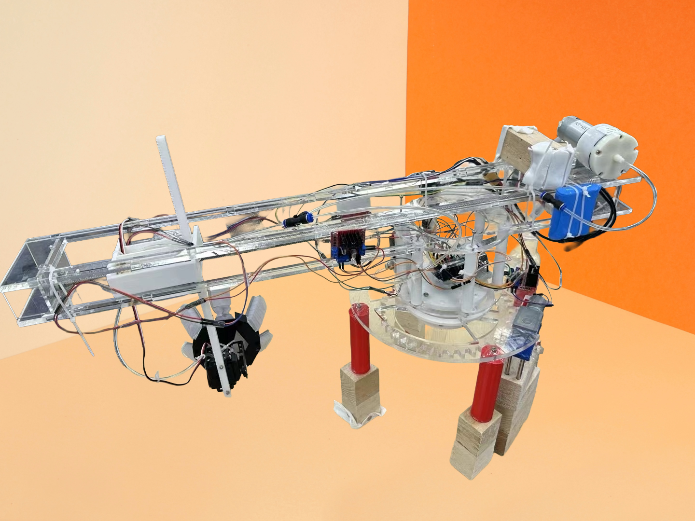
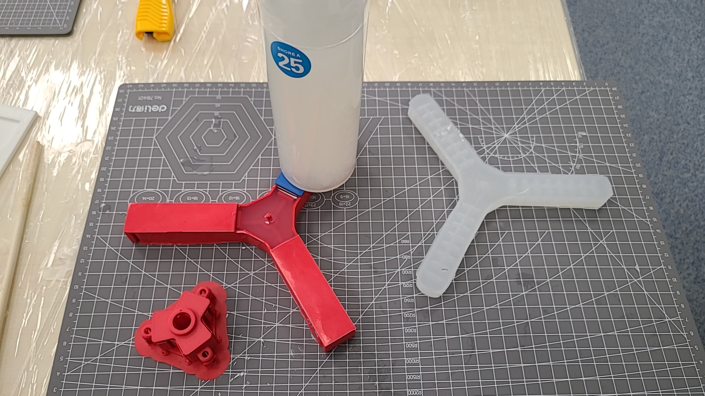
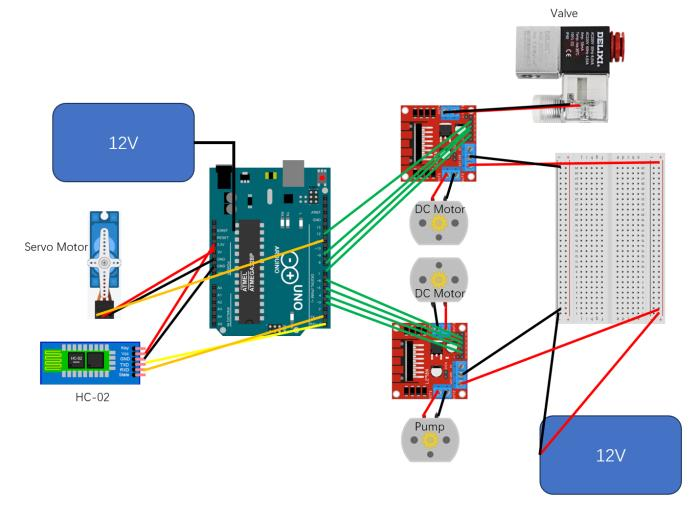
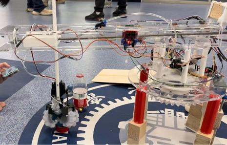

## Overview

Course project for ME250, leading a four-person team to design and manufacture a robotic arm with flexible silicone grippers capable of adaptive grasping.

## Key Contributions

- Led a four-person team in designing and manufacturing a robotic arm with soft grippers made of silicone
- Designed and assembled a 5 DOF robotic arm and its circuits to achieve flexible gripping capabilities
- Developed an Arduino-based control system that connects to a mobile app, enabling remote control

## Project Gallery

