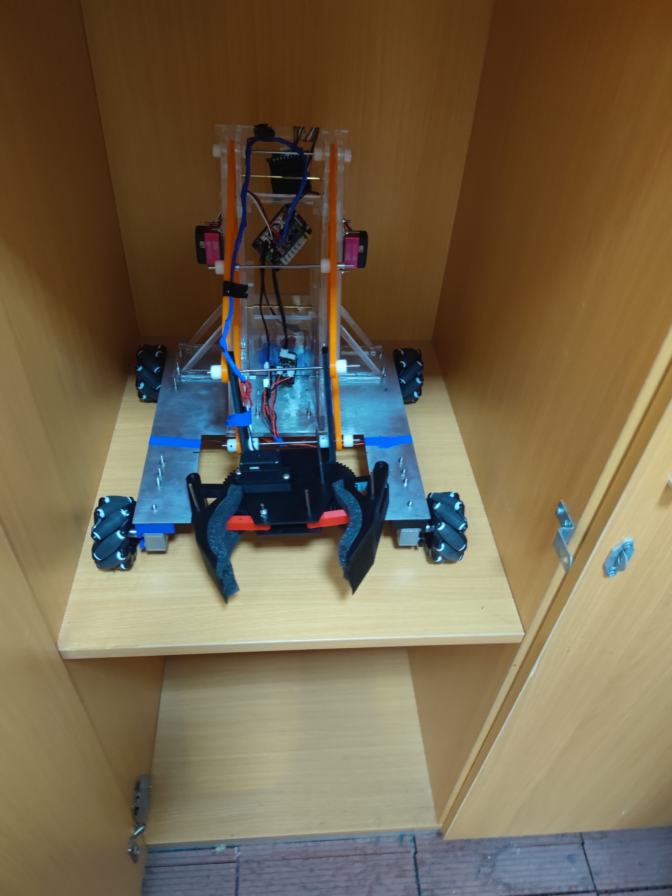
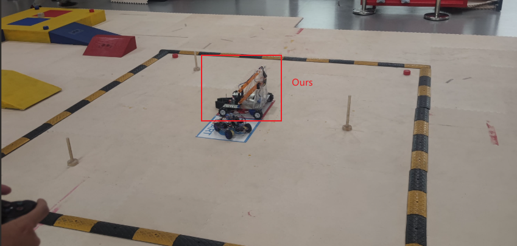
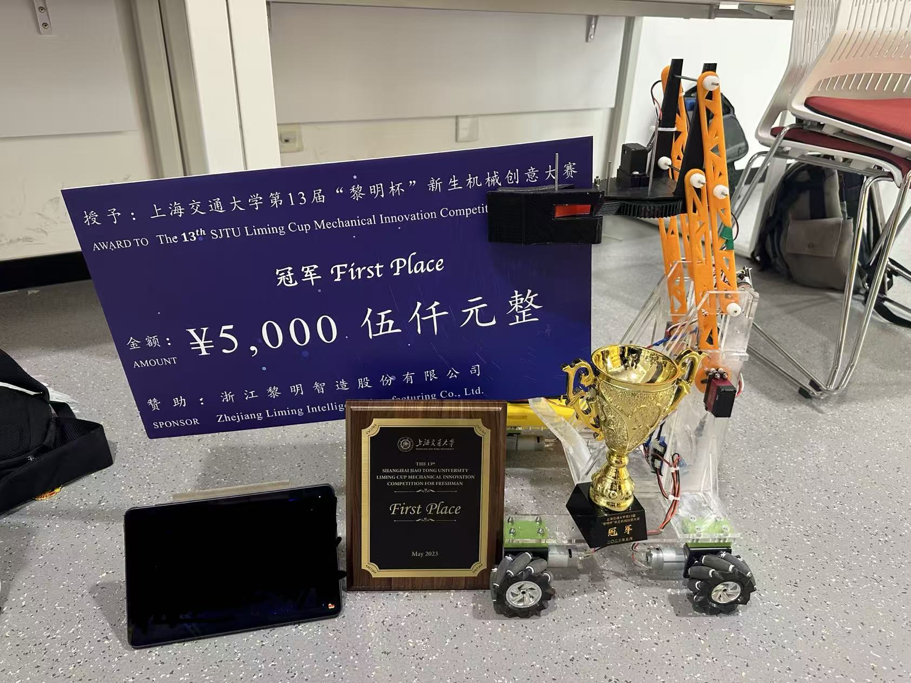

## Overview

Freshman mechanical innovation competition project at SJTU, developing a Bluetooth-controlled robotics vehicle.

## Key Contributions

- Developed an Arduino-based Bluetooth control system using the HC-06 module for a PS2 controller.
- Designed circuits integrated with the mechanical chassis and collaborated on assembly and testing.
- Won First Prize in the 13th SJTU "Liming Cup" Mechanical Innovation Competition For Freshmen.

## Project Gallery

