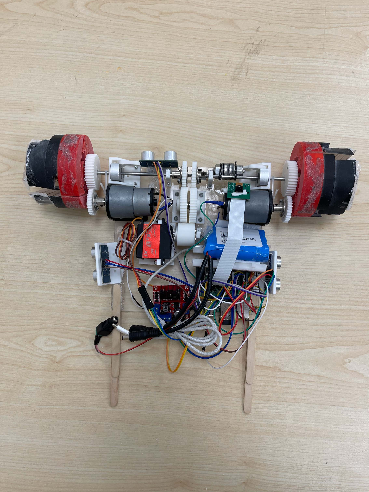

## Overview

This ME350 project develops a small mobile rover with rotatable, hook-shaped wheels driven by a four-bar linkage mechanism. Separate motors handle traction and wheel transformation, allowing the rover to operate in two modes: a compact mode for flat surfaces and height limits, and an expanded mode for stair and sand traversal. A Raspberry Pi coordinates ultrasonic sensors and an on-board camera to detect obstacles and trigger wheel shape changes, enabling robust navigation across complex terrain under tight weight, size, and cost constraints.

## Project Gallery

<video src="/assets/video/350-explosive.mp4" controls title="Explosive View"></video>

<video src="/assets/video/demo-climb.mp4" controls title="Climbing Demo"></video>

